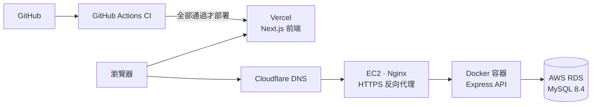
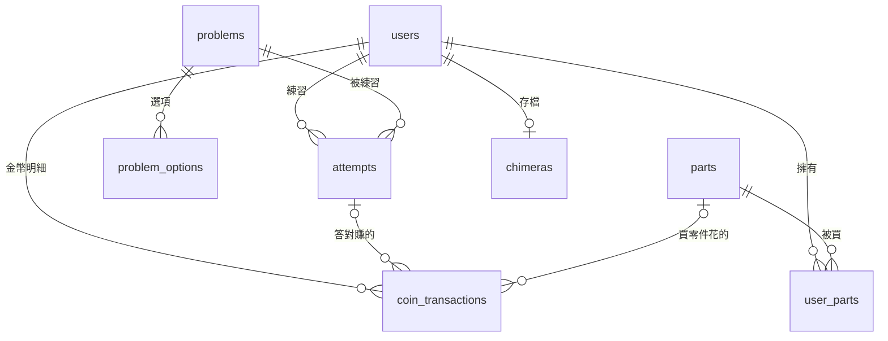

# Bug Clinic 除蟲動物診所


練習程式除錯的網頁遊戲。每一題是一段有 bug 的程式碼，玩家先找出錯誤在哪一行，再選出正確的修法。練習紀錄、金幣和經驗值都存在自己的後端，用金幣可以在合成獸實驗室買零件，再自己改 HTML、CSS、JavaScript 打造一隻合成獸。

畫面用寵物診所的像素風包裝：每一題是一隻生病的動物，修好 bug 就是治好牠。

- 網站：https://bug-clinic.vercel.app
- API：https://bug-clinic-api.minruei.com

## 功能

| 功能         | 說明                                                                                           |
| ------------ | ---------------------------------------------------------------------------------------------- |
| 除錯練習     | 10 個主題、100 題。找錯誤行時點錯扣 5 秒可以再找；選修法只有一次機會，選錯就公布正確答案和解說 |
| 會員         | 自己實作註冊登入，密碼用 bcrypt 雜湊，登入後發 JWT                                             |
| 病歷本       | 每次練習的題目、結果、花費秒數                                                                 |
| 住院部       | 最後一次沒答對的題目會留在這裡，答對才出院                                                     |
| 圖鑑         | 依練習紀錄解鎖動物和神獸                                                                       |
| 金幣         | 答對依剩餘時間發金幣；餘額和每一筆明細分開存，可以互相對帳                                     |
| 合成獸實驗室 | 用金幣買零件，裝到合成獸上再自己改程式碼，右邊即時預覽，可以存檔                               |

## 架構



| 層     | 技術                                                                      |
| ------ | ------------------------------------------------------------------------- |
| 前端   | Next.js 15（App Router）、React、TypeScript，部署在 Vercel                |
| 後端   | Node.js、Express 5、TypeScript，打包成 Docker 映像檔跑在 AWS EC2          |
| 網路   | Cloudflare DNS、Nginx 反向代理、Let's Encrypt 憑證                        |
| 資料庫 | AWS RDS MySQL 8.4                                                         |
| 品質   | Prettier、ESLint、型別檢查、npm audit、Playwright E2E、CodeQL、Dependabot |

## 資料表



- `users.coins` 存餘額給畫面用，`coin_transactions` 存每一筆進出給後台查帳，兩者在同一個 transaction 裡更新
- `user_parts` 的 `(user_id, part_id)` 設為 UNIQUE，同一個零件資料庫層級就不能買兩次
- `chimeras.user_id` 設為 UNIQUE，一個玩家一隻合成獸，存檔用 upsert

## 技術重點

**答案和金幣都由後端判斷**
正確答案不會送到前端；計時用資料庫的 `TIMESTAMPDIFF` 算，前端的倒數只是畫面，改前端也作弊不了。

**購買零件不會重複扣款**
扣餘額、記錄擁有、寫明細放在同一個 transaction。第一句就用 `SELECT ... FOR UPDATE` 鎖住玩家這一列，連點送來的第二個請求會排隊，排到時查到的是最新資料。鎖一定要放在第一句：InnoDB 會在 transaction 第一次普通查詢時建立快照，鎖放後面的話，第二個請求看到的是舊快照。

**答對不會重複領獎**
測試時發現，同一次看診同時送出三次正確答案，會領到三倍金幣。改成 `UPDATE attempts ... WHERE id = ? AND finished_at IS NULL`，再看 `affectedRows`：只有第一個請求改得到，後面的改到 0 筆就取消。

**玩家的程式關在沙盒裡跑**
實驗室的預覽是 `iframe` 加上 `sandbox="allow-scripts"`，玩家寫的 JavaScript 可以跑，但拿不到網站的 localStorage、登入 token，也改不了外面的頁面。

**AI 出題實驗**
`server/scripts/generate-problem.ts` 用 Claude API 照題庫格式出題，並自動檢查格式。比較不同模型後發現，便宜的模型會出「格式正確、但程式根本不會執行」的題目，所以 AI 產生的內容一定要人工審核才上架。

## API

成功回傳 `{ data }`，失敗回傳 `{ error: true, message }`。

| 方法 | 路徑                       | 說明                       |
| ---- | -------------------------- | -------------------------- |
| POST | `/api/user`                | 註冊                       |
| PUT  | `/api/user/auth`           | 登入，回傳 JWT             |
| GET  | `/api/user/auth`           | 目前登入的使用者           |
| GET  | `/api/problems`            | 題目列表                   |
| POST | `/api/attempts`            | 開始看診                   |
| POST | `/api/attempts/:id/line`   | 找錯誤行                   |
| POST | `/api/attempts/:id/answer` | 選修法，答對發金幣和經驗值 |
| GET  | `/api/attempts`            | 病歷本                     |
| GET  | `/api/review`              | 住院部                     |
| GET  | `/api/parts`               | 零件商店                   |
| POST | `/api/parts/:id/purchase`  | 買零件                     |
| GET  | `/api/chimera`             | 讀取自己的合成獸           |
| PUT  | `/api/chimera`             | 存檔                       |

## 本機開發

需要 Node.js 22 和 MySQL 8。

**資料庫**

```bash
mysql -u root -p < server/db/schema.sql
mysql -u root -p bug_clinic < server/db/seed.sql
mysql -u root -p bug_clinic < server/db/add-bank.sql
mysql -u root -p bug_clinic < server/db/add-lab.sql
mysql -u root -p bug_clinic < server/db/seed-parts.sql
```

**後端**：在 `server/.env` 設定 `DB_HOST`、`DB_USER`、`DB_PASSWORD`、`DB_NAME`、`JWT_SECRET`、`FRONTEND_URL`

```bash
cd server
npm install
npm run dev
```

**前端**：在 `.env.local` 設定 `NEXT_PUBLIC_API_URL=http://localhost:8000`

```bash
npm install
npm run dev
```

打開 http://localhost:3000

## 指令

| 指令                   | 用途                        |
| ---------------------- | --------------------------- |
| `npm run format`       | 用 Prettier 統一格式        |
| `npm run format:check` | 檢查格式                    |
| `npm run lint`         | ESLint 檢查                 |
| `npm run typecheck`    | TypeScript 型別檢查         |
| `npm run build`        | 建置正式版                  |
| `npm run test:e2e`     | Playwright 測試（先 build） |

## CI 與安全

- **CI**：每次 push 都會跑格式、Lint、型別檢查、套件安全掃描、建置，再跑電腦版和手機版的 E2E 測試，全部通過才部署到 Vercel
- **CodeQL**：GitHub 的程式碼安全掃描，每週也會自動跑一次
- **Dependabot**：每週檢查套件更新，自動開 PR
- **安全標頭**：在 `next.config.ts` 設定，防止網站被嵌入其他頁面、限制瀏覽器權限
- **SQL Injection**：所有查詢都用 `?` 佔位，不把使用者輸入直接接進 SQL

## 開發方式

這個專案用 Claude 協作開發。玩法、零件、資料表怎麼設計由我決定，Claude 協助產生程式碼和解釋觀念；每個功能都在本機測試過，並確認自己能說明它在做什麼才上線。
