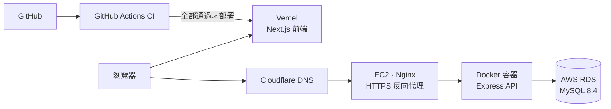
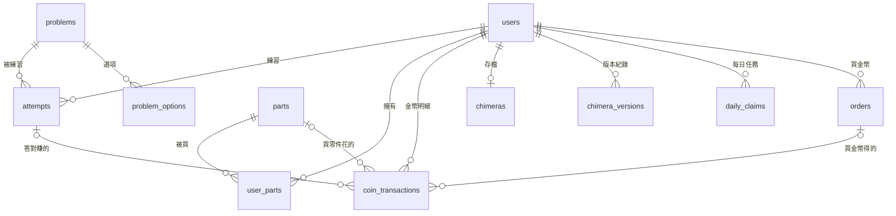

# Bug Clinic 除蟲動物診所


練習程式除錯的網頁遊戲。每一題是一段有 bug 的程式碼，玩家先找出錯誤在哪一行，再選出正確的修法。練習紀錄、金幣和經驗值都存在自己的後端，用金幣可以在合成獸實驗室買零件，再自己改 HTML、CSS、JavaScript 打造一隻合成獸；每天還有一題用程式改合成獸的每日任務。

畫面用寵物診所的像素風包裝：每一題是一隻生病的動物，修好 bug 就是治好牠。

- 網站：https://bug-clinic.vercel.app
- API：https://bug-clinic-api.minruei.com

## 功能

| 功能         | 說明                                                                                                         |
| ------------ | ------------------------------------------------------------------------------------------------------------ |
| 除錯練習     | 10 個主題、300 題。找錯誤行時點錯扣 5 秒可以再找；選修法只有一次機會，選錯就公布正確答案和解說               |
| 會員         | 自己實作註冊登入，密碼用 bcrypt 雜湊，登入後發 JWT                                                           |
| 病歷本       | 每次練習的題目、結果、花費秒數                                                                               |
| 住院部       | 最後一次沒答對的題目會留在這裡，答對才出院                                                                   |
| 圖鑑         | 依練習紀錄解鎖動物和神獸                                                                                     |
| 金幣         | 答對依剩餘時間發金幣；餘額和每一筆明細分開存，可以互相對帳。不夠用可以用信用卡買（TapPay 測試環境）          |
| 合成獸實驗室 | 編輯器分成 HTML 骨架、CSS 烤漆、JS 引擎、零件形狀四格，右邊即時預覽；有錯誤主控台、遊玩模式、版本紀錄        |
| 零件系統     | 9 個部位、每個部位 9 款，共 81 個像素風零件。同部位裝上會互相替換，可以卸下、復原，還沒買也能先看程式碼      |
| 新手教程     | 第一次進實驗室先用一隻練習用的合成獸，改四個地方（換毛色、說話、改形狀、喊跳）認識三格程式碼，完成發金幣     |
| 動作參考     | 20 招合成獸的動作，分四級，每招有示範預覽和一行一行的白話解釋，可以直接放進自己的合成獸                      |
| 每日任務     | 每天一題（簡單、普通、挑戰），三層提示：方向、去哪裡找參考、可以直接貼的範例。完成發 20 金幣，一天只能領一次 |
| 像素模式     | 預覽畫面變成 4px 一格的馬賽克，玩家自己寫的圓形、斜線也會變成像素風，不改到程式碼                            |

## 架構



| 層     | 技術                                                                                       |
| ------ | ------------------------------------------------------------------------------------------ |
| 前端   | Next.js 15（App Router）、React、TypeScript，部署在 Vercel                                 |
| 後端   | Node.js、Express 5、TypeScript，打包成 Docker 映像檔跑在 AWS EC2                           |
| 網路   | Cloudflare DNS、Nginx 反向代理、Let's Encrypt 憑證                                         |
| 資料庫 | AWS RDS MySQL 8.4                                                                          |
| 品質   | Prettier、ESLint、型別檢查、Vitest 單元測試、npm audit、Playwright E2E、CodeQL、Dependabot |

## 資料表



- `users.coins` 存餘額給畫面用，`coin_transactions` 存每一筆進出給後台查帳，兩者在同一個 transaction 裡更新
- `user_parts` 的 `(user_id, part_id)` 設為 UNIQUE，同一個零件資料庫層級就不能買兩次
- `chimeras.user_id` 設為 UNIQUE，一個玩家一隻合成獸，存檔用 upsert；每次存檔另外留一份在 `chimera_versions`，每個玩家只留最新 20 筆
- `daily_claims` 的 `(user_id, claim_date)` 設為 UNIQUE，同一天同時送很多次領獎，只有第一筆寫得進去

## 技術重點

**答案和金幣都由後端判斷**
正確答案不會送到前端；計時用資料庫的 `TIMESTAMPDIFF` 算，前端的倒數只是畫面，改前端也作弊不了。

**購買零件不會重複扣款**
扣餘額、記錄擁有、寫明細放在同一個 transaction。第一句就用 `SELECT ... FOR UPDATE` 鎖住玩家這一列，連點送來的第二個請求會排隊，排到時查到的是最新資料。鎖一定要放在第一句：InnoDB 會在 transaction 第一次普通查詢時建立快照，鎖放後面的話，第二個請求看到的是舊快照。

**答對不會重複領獎**
測試時發現，同一次看診同時送出三次正確答案，會領到三倍金幣。改成 `UPDATE attempts ... WHERE id = ? AND finished_at IS NULL`，再看 `affectedRows`：只有第一個請求改得到，後面的改到 0 筆就取消。

**玩家的程式關在沙盒裡跑**
實驗室的預覽是 `iframe` 加上 `sandbox="allow-scripts"`，玩家寫的 JavaScript 可以跑，但拿不到網站的 localStorage、登入 token，也改不了外面的頁面。

**每日任務前後端各檢查一次**
前端在沙盒預覽裡把玩家的程式真的跑起來，量畫面上的結果（例如眼睛是不是紅色、點一下有沒有加上 class），玩家馬上知道過了沒。後端不能執行玩家的程式，領獎時改讀資料庫裡存檔的程式碼，解析 CSS 規則和 JS 寫法再判斷一次；兩邊用同一份檢查程式（`server/src/challenges.ts`），前端不會比後端寬鬆。CSS 檢查看得懂簡單的變數，零件常見的 `background: var(--eye-color)` 只改變數也算數。

**零件程式碼用標記包起來**
裝上零件時，零件的程式碼用 `/* [horn:7] 鹿角 開始 */` 這種標記包起來，換零件、卸下時只動標記裡的段落，玩家自己寫的程式碼不會被蓋掉。零件的 CSS 用一行分隔線分成兩段：常改的顏色和位置放進 CSS 烤漆，一大段畫形狀的程式放進零件形狀，初學者打開 CSS 不會先被嚇到。組預覽頁時零件形狀排在前面，玩家在 CSS 烤漆寫的設定可以蓋過形狀。

**零件跟著身體定位**
零件裝在 `.body` 裡面，位置讀身體定義的 CSS 變數（例如 `--eye-y`、`--neck-y`），換成圓滾滾、高高瘦瘦這些身體，眼睛、腳、翅膀都會跟著貼好。身體本身是透明的容器，看得到的身體畫在 `::before`、`::after`，翅膀、披風才排得到身體後面，跳的時候也一起動。零件用 `scripts/parts/parts.py` 產生，加上 `--check` 會輸出 8 種身體 × 每個零件的檢查頁。

**像素模式用 SVG 濾鏡做**
每 4 × 4 格只取一個點的顏色再放大填滿整格。濾鏡只在組預覽頁時插進去，加在 `.body` 上：存檔的程式碼不變，對話框在 `.body` 外面，文字不會被打成馬賽克。

**錯誤主控台換算行號**
預覽頁前面還有 HTML、CSS 和抓錯誤的程式，瀏覽器回報的行號是整個預覽頁的第幾行。主控台會扣掉前面的行數，換算成 JS 引擎格裡的第幾行，點一下就跳到那一行。

**流量限制**
用 `express-rate-limit` 依 IP 限制次數，超過回 429：登入 15 分鐘內失敗 10 次（只算失敗，正常登入登出不會被擋）、註冊 1 小時 5 次、付款 1 分鐘 5 次。答題這些正常玩的 API 不限制。

**存檔上限用位元組算**
合成獸的程式碼存在 `TEXT` 欄位，最多 65535 位元組，中文字一個佔 3 個。所以存檔上限用位元組算（60000），9 個部位都裝最長的零件、再加上動作參考 20 招也存得下，不會因為中文註解多就寫不進資料庫。

**AI 出題實驗**
`server/scripts/generate-problem.ts` 用 Claude API 照題庫格式出題，並自動檢查格式。比較不同模型後發現，便宜的模型會出「格式正確、但程式根本不會執行」的題目，所以 AI 產生的內容一定要人工審核才上架。

## API

成功回傳 `{ data }`，失敗回傳 `{ error: true, message }`。

| 方法 | 路徑                        | 說明                       |
| ---- | --------------------------- | -------------------------- |
| POST | `/api/user`                 | 註冊                       |
| PUT  | `/api/user/auth`            | 登入，回傳 JWT             |
| GET  | `/api/user/auth`            | 目前登入的使用者           |
| GET  | `/api/problems`             | 題目列表                   |
| POST | `/api/attempts`             | 開始看診                   |
| POST | `/api/attempts/:id/line`    | 找錯誤行                   |
| POST | `/api/attempts/:id/answer`  | 選修法，答對發金幣和經驗值 |
| GET  | `/api/attempts`             | 病歷本                     |
| GET  | `/api/review`               | 住院部                     |
| GET  | `/api/parts`                | 零件商店                   |
| POST | `/api/parts/:id/purchase`   | 買零件                     |
| GET  | `/api/chimera`              | 讀取自己的合成獸           |
| PUT  | `/api/chimera`              | 存檔                       |
| GET  | `/api/chimera/versions`     | 版本紀錄列表               |
| GET  | `/api/chimera/versions/:id` | 拿某個版本的程式碼         |
| POST | `/api/tutorial/complete`    | 完成新手教程，第一次發金幣 |
| GET  | `/api/daily`                | 今天的每日任務             |
| POST | `/api/daily/claim`          | 領每日任務的獎勵           |
| GET  | `/api/coin-packages`        | 金幣方案                   |
| POST | `/api/orders`               | 用信用卡買金幣             |

## 本機開發

需要 Node.js 22 和 MySQL 8。

**資料庫**

```bash
mysql -u root -p < server/db/schema.sql
mysql -u root -p bug_clinic < server/db/seed.sql
mysql -u root -p bug_clinic < server/db/update-symptoms.sql
mysql -u root -p bug_clinic < server/db/update-pets.sql
mysql -u root -p bug_clinic < server/db/update-explanations.sql
mysql -u root -p bug_clinic < server/db/add-bank.sql
mysql -u root -p bug_clinic < server/db/add-bank-2.sql
mysql -u root -p bug_clinic < server/db/add-lab.sql
mysql -u root -p bug_clinic < server/db/add-payment.sql
mysql -u root -p bug_clinic < server/db/add-part-slots.sql
mysql -u root -p bug_clinic < server/db/seed-parts-v2.sql
mysql -u root -p bug_clinic < server/db/add-versions.sql
mysql -u root -p bug_clinic < server/db/add-daily.sql
```

**後端**：在 `server/.env` 設定 `DB_HOST`、`DB_USER`、`DB_PASSWORD`、`DB_NAME`、`JWT_SECRET`、`FRONTEND_URL`

```bash
cd server
npm install
npm run dev
```

**前端**：在 `.env.local` 設定 `NEXT_PUBLIC_API_URL=http://localhost:8000`

```bash
npm install
npm run dev
```

打開 http://localhost:3000

## 指令

| 指令                   | 用途                        |
| ---------------------- | --------------------------- |
| `npm run format`       | 用 Prettier 統一格式        |
| `npm run format:check` | 檢查格式                    |
| `npm run lint`         | ESLint 檢查                 |
| `npm run typecheck`    | TypeScript 型別檢查         |
| `npm run build`        | 建置正式版                  |
| `npm test`             | Vitest 單元測試（前端）     |
| `npm run test:e2e`     | Playwright 測試（先 build） |

## CI 與安全

- **CI**：每次 push 都會跑格式、Lint、型別檢查、前後端的單元測試、套件安全掃描、建置，再跑電腦版和手機版的 E2E 測試，全部通過才部署到 Vercel
- **CodeQL**：GitHub 的程式碼安全掃描，每週也會自動跑一次
- **Dependabot**：每週檢查套件更新，自動開 PR
- **安全標頭**：在 `next.config.ts` 設定，防止網站被嵌入其他頁面、限制瀏覽器權限
- **SQL Injection**：所有查詢都用 `?` 佔位，不把使用者輸入直接接進 SQL
- **流量限制**：登入、註冊、付款依 IP 限制次數，擋暴力試密碼和狂打付款
- **沙盒預覽**：玩家的程式碼只在 `sandbox="allow-scripts"` 的 iframe 裡跑，碰不到網站的登入 token

## 開發方式

這個專案用 Claude 協作開發。玩法、零件、資料表怎麼設計由我決定，Claude 協助產生程式碼和解釋觀念；每個功能都在本機測試過，並確認自己能說明它在做什麼才上線。
